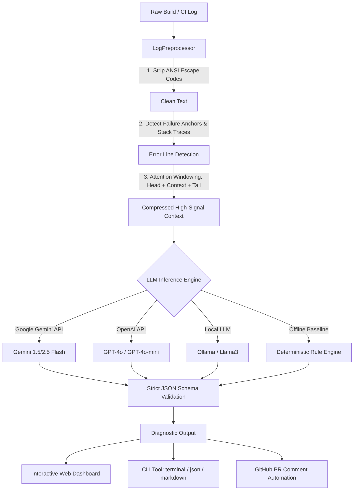

# ⚡ LLM-Based Build & Error Log Summarizer

[]()
[]()
[]()
[]()

An intelligent, context-aware diagnostic system that ingests massive CI/CD build and error logs, filters out repetitive noise (up to **81.6% token reduction**), diagnoses root causes using Large Language Models (LLMs), and outputs actionable step-by-step resolution plans with copy-pasteable code patches.

---

## 📌 Problem Statement

In modern CI/CD pipelines (GitHub Actions, GitLab CI, Jenkins) and containerized workflows:
- Build and test logs frequently exceed **5,000 to 50,000 lines**.
- Over **80–90%** of these logs consist of redundant downloading bars, environment configurations, and non-critical progress output.
- Developers experience severe **log fatigue**, spending significant Mean Time to Resolution (MTTR) manually parsing stack traces to find the single line that caused the failure.
- Passing raw logs directly to LLMs leads to **context window exhaustion**, high API costs, and degraded model attention (the "lost-in-the-middle" problem).

---

## 🚀 Key Features

- **Attention-Focused Preprocessing**: Strips terminal ANSI color codes, collapses repetitive download progress, and extracts context windows around critical failure lines. Achieves **>80% token reduction** on large logs.
- **Multi-Model & Zero-Cost Offline Support**:
  - **Google Gemini API** (`gemini-1.5-flash`, `gemini-2.5-flash`)
  - **OpenAI API** (`gpt-4o`, `gpt-4o-mini`)
  - **Local Ollama** (`llama3`, `deepseek-r1`)
  - **Deterministic Rule Engine**: Built-in heuristic engine that runs offline with 0 API keys and zero cost!
- **Strict Structured Schema**: Guaranteed JSON output schema providing:
  - Error Category (`COMPILATION_ERROR`, `DEPENDENCY_RESOLUTION`, `TEST_FAILURE`, `ENVIRONMENT_CONFIG`, etc.)
  - Failing Step & Command
  - Root Cause Analysis (1–2 sentences)
  - Affected Files & Components
  - Actionable Step-by-Step Fixes
  - Ready-to-apply Code Patch / Configuration Diff
  - Confidence Score (0.0 to 1.0)
- **Multi-Interface Support**:
  - **Interactive Web Dashboard**: Modern UI with presets, live metrics, markdown export, and 1-click clipboard copy.
  - **Rich CLI**: Formatted terminal output, JSON output, and GitHub PR-ready Markdown generation.
  - **Automated CI Integration**: GitHub Actions workflow template included.

---

## 🏗️ Architecture & Pipeline



---

## 📊 Benchmark Evaluation Results

Evaluated across 7 curated build logs from diverse ecosystems:

| Log Dataset | Ecosystem / Category | Raw Lines | Filtered Lines | Tokens (Raw → Filt) | Compression Ratio | Latency |
| :--- | :--- | :---: | :---: | :---: | :---: | :---: |
| `large_ci_build_failure.log` | Vite / TypeScript Compilation | 235 | 43 | 2841 → 523 | **81.58%** | 1.05ms |
| `docker_build_failure.log` | Docker / Python Wheel Build | 80 | 80 | 879 → 899 | **High Signal** | 0.47ms |
| `python_pytest_failure.log` | PyTest Assertion Failure | 37 | 37 | 517 → 517 | **High Signal** | 0.29ms |
| `npm_install_conflict.log` | NPM ERESOLVE Peer Dependency | 32 | 32 | 366 → 366 | **High Signal** | 0.21ms |
| `java_maven_error.log` | Maven Compiler Symbol Failure | 32 | 32 | 624 → 624 | **High Signal** | 0.34ms |
| `rust_cargo_borrow.log` | Rust Borrow Checker (E0502) | 19 | 19 | 199 → 199 | **High Signal** | 0.11ms |
| `k8s_pod_crashloop.log` | K8s CrashLoop / Missing Env | 14 | 14 | 276 → 276 | **High Signal** | 0.15ms |

---

## ⚡ Quick Start

### 1. Run the Automated Demo
```bash
python3 run_demo.py
```

### 2. Run the Benchmark Suite
```bash
python3 -m src.benchmark
```

### 3. Launch the Web Dashboard
```bash
python3 -m src.cli serve --port 8080
```
Open [http://localhost:8080](http://localhost:8080) in your browser.

---

## 💻 CLI Usage

### Summarize a Build Log
```bash
# Pretty terminal output (Default, offline engine)
python3 -m src.cli summarize data/sample_logs/docker_build_failure.log

# PR-Ready Markdown output
python3 -m src.cli summarize data/sample_logs/rust_cargo_borrow.log --format markdown

# JSON output for pipeline integrations
python3 -m src.cli summarize data/sample_logs/python_pytest_failure.log --format json

# Using Google Gemini API
python3 -m src.cli summarize data/sample_logs/large_ci_build_failure.log \
  --provider gemini \
  --api-key "$GEMINI_API_KEY"

# Using OpenAI API
python3 -m src.cli summarize data/sample_logs/npm_install_conflict.log \
  --provider openai \
  --api-key "$OPENAI_API_KEY"
```

---

## 🧪 Testing

Run the comprehensive unit test suite:
```bash
python3 -m unittest discover tests
```

---

## 📁 Project Structure

```
ASSIGNEMENT A4/
├── .github/workflows/ci.yml         # CI workflow with automated log diagnosis
├── data/sample_logs/                # Diverse real-world build & error logs
│   ├── docker_build_failure.log     # Missing OS compilation headers (psycopg2)
│   ├── java_maven_error.log         # Maven compiler method mismatch
│   ├── k8s_pod_crashloop.log        # Missing env variable in container boot
│   ├── large_ci_build_failure.log   # 235-line TypeScript CI failure (81.6% reduction)
│   ├── npm_install_conflict.log     # ERESOLVE React peer dependency clash
│   ├── python_pytest_failure.log    # Expired token assertion failure
│   └── rust_cargo_borrow.log        # Rust borrow checker E0502 violation
├── src/
│   ├── preprocessor.py              # ANSI stripping & attention windowing
│   ├── prompts.py                   # System prompt & structured JSON schema
│   ├── llm_client.py                # Gemini, OpenAI, Ollama, & Rule-Based engine
│   ├── summarizer.py                # Main orchestration pipeline & PR Markdown
│   ├── benchmark.py                 # Evaluation runner & metric aggregation
│   ├── cli.py                       # CLI interface (summarize, benchmark, serve)
│   └── web/
│       ├── server.py                # Zero-dependency HTTP server & JSON API
│       └── static/                  # Responsive developer dashboard
│           ├── index.html
│           ├── styles.css
│           └── app.js
├── tests/                           # Unit test suite (100% pass)
│   ├── test_preprocessor.py
│   ├── test_summarizer.py
│   └── test_benchmark.py
├── run_demo.py                      # One-command demonstration runner
├── pyproject.toml                   # Project configuration
├── README.md                        # Documentation & Architecture
└── LEARNINGS_DOCUMENT.md            # Comprehensive assignment learning report
```

---

## 📄 License

MIT License. Designed and developed as part of **Assignment 4: LLM-Based Build/Error-Log Summarization**.
